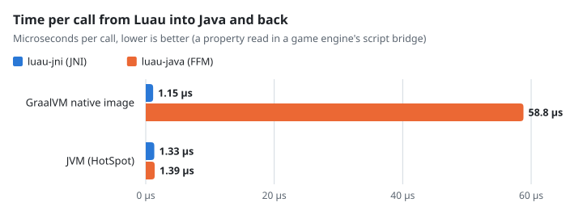
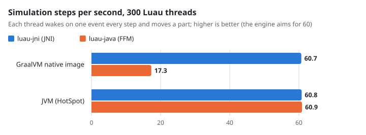

# luau-jni

[Luau](https://github.com/luau-lang/luau)'s compiler, VM and native code generator for Java, through JNI.

It's a thin binding: `io.github.forka42.luaujni.LuauJni` is Luau's C API as static methods. A VM is a `long` (its `lua_State*`), and strings are byte arrays, so any Luau string survives the trip, not only valid UTF-8. It's built for GraalVM Native Image as much as for the JVM. Native Image runs JNI calls at full speed, but it runs FFM bindings such as [luau-java](https://github.com/hollow-cube/luau-java)'s about 50 times slower than the JVM does ([benchmarks](#benchmarks)).

- **Errors:** an error raised in Luau is thrown as `LuauError`, with the stack left as it was before the call. Calls that can run a metamethod (`getField`, `setField`, `getGlobal`, `setGlobal`) are protected, so a Luau error never unwinds through a JNI frame.
- **Java functions:** `pushFunction` takes a `LuauJni.Callbacks` and an index. If the Java code throws, its message is raised in Luau as an error.
- **Flags:** every Luau flag but the experimental ones is on, as in luau-java and Luau's own command-line tools.
- **Linking:** each platform's library is a single file. Luau is linked in, and so is the C/C++ runtime.

## Using it

Each release's jars are attached to its GitHub release, so Gradle can fetch them straight from there:

```kotlin
repositories {
    ivy {
        url = uri("https://github.com/forka42/luau-jni/releases/download")
        patternLayout { artifact("v[revision]/[module]-[revision].[ext]") }
        metadataSources { artifact() }
        content { includeGroup("io.github.forka42") }
    }
}

dependencies {
    implementation("io.github.forka42:luau-jni:0.1.0")
    runtimeOnly("io.github.forka42:luau-jni-natives-windows-x64:0.1.0")   // windows-x64, linux-x64, linux-arm64, macos-arm64
}
```

```java
LuauJni.load();                         // or load(dir): the natives jar's library is copied out there first
byte[] code = LuauJni.compile("return 6 * 7".getBytes(UTF_8), 1, 1, null);
long L = LuauJni.open();
LuauJni.openLibs(L);
LuauJni.load(L, "=example".getBytes(UTF_8), code);
LuauJni.call(L, 0, 1);
double answer = LuauJni.toNumber(L, -1);    // 42
LuauJni.close(L);
```

`LuauJni.load()` uses the file that the system property `luaujni.library.path` names, if it's set. Otherwise it copies the natives jar's library into `java.io.tmpdir/luau-jni`. Antivirus software can block a DLL written to a temporary folder, so an application can pass its own folder to `load(dir)` instead.

The jar carries its Native Image metadata (`META-INF/native-image`), so a native build needs no extra configuration.

## Benchmarks

These numbers come from a game engine that runs its scripts on Luau. It was measured with luau-java 1.2.1 and with luau-jni 0.1.0, each on GraalVM Native Image (Oracle GraalVM 25, `-O3`) and on HotSpot (JDK 25), on Windows 11 x64. Each run used one Luau script:

- 300 threads waiting on one event, each moving a part every simulation step.
- A loop of 20,000 property reads, each a call from Luau into Java and back.

The figures are averages over rounds after warm-up.

<picture>
  <source media="(prefers-color-scheme: dark)" srcset="docs/benchmarks/call-time-dark.svg">
  
</picture>

<picture>
  <source media="(prefers-color-scheme: dark)" srcset="docs/benchmarks/steps-dark.svg">
  
</picture>

| Runtime | Binding | Per call | Steps per second |
|---|---|---:|---:|
| GraalVM native image | luau-jni | 1.15 µs | 60.7 |
| GraalVM native image | luau-java | 58.8 µs | 17.3 |
| JVM (HotSpot) | luau-jni | 1.33 µs | 60.8 |
| JVM (HotSpot) | luau-java | 1.39 µs | 60.9 |

On the JVM the two bindings are level. On a native image, luau-java's FFM calls run through Native Image's slower foreign-call path and stop at a safepoint on the way back, while JNI calls don't. Pure Luau code ran at the same speed in every case, about 15 ns per arithmetic operation, so the whole difference is the cost of crossing between Luau and Java. `docs/benchmarks/charts.py` draws the charts from these numbers.

### Crossing, call by call

`./gradlew bench` (HotSpot) and `./gradlew benchNative` (a GraalVM native image, `-O3`) time each kind of crossing on its own (`src/bench`). On Windows 11 x64, JDK 25 and Oracle GraalVM 25, the best of 15 rounds of a million calls:

| | Native image | HotSpot |
|---|---:|---:|
| Luau arithmetic, interpreted / native code (per iteration) | 13.2 / 3.5 ns | 13.2 / 3.4 ns |
| Classic call: empty | 104 ns | 206 ns |
| Classic call: two strings in, a number out | 305 ns | 547 ns |
| Fast function: a handle and a name in, a number out | 172 ns | 276 ns |
| Fast function: `part:GetSpeed()` (`__namecall`) | 167 ns | 286 ns |
| Field: `rec.Speed` read | 42 ns | 42 ns |
| Field: `rec.Speed` read, native code | 35 ns | 34 ns |
| Field: `rec.Speed = i` | 42 ns | 40 ns |
| Java calling a Luau function | 132 ns | 90 ns |

A call from native code into Java costs about 100 ns on a native image and 200 ns on HotSpot, however little it carries. Fast functions make that the whole cost of a call, and fields avoid it.

## Fast functions, handles and fields

The classic API crosses into native code once per argument and result, and makes a Java string for every name. Three additions make an engine's API cheap to call:

- **Fast functions** (`fastInit`, `pushFastFunction`, `LuauJni.Frame`). A call crosses once: its arguments are written into the VM's frame (native memory that Java reads as a direct `ByteBuffer`), Java's `FastCallbacks.call(id, L, base)` reads them there and writes its results there, and returns how many. It can also return an error or a yield. Names registered with `registerAtoms` cross as numbers (Luau's string atoms), so a property's or a method's name costs nothing to read. A fast function made with `namecall` serves as a `__namecall` metamethod, with the method's name first.
- **Handles** (`setHandleMetatable`, `pushHandle`, `toHandle`, `drainCollected`). These are tagged userdata holding a 64-bit id of Java's, one object in Luau per id for as long as Luau holds it. Their tag's metatable gives them properties and methods, and Java is told when Luau lets one go.
- **Fields** (`storeInit`, `defineFields`, `pushFieldIndex`, `pushFieldNewIndex`, `pushHandleRecord`, `drainChanged`). A handle's plain data (numbers, vectors, booleans, names, other handles) sits in a record in native memory that both sides read. `__index` and `__newindex` serve those fields without calling Java at all. A write sets the field's bit in the record's changed mask and lists the record (once) for Java to see to. Anything that isn't a field, such as a method, goes to the tag's fast function.

## Building

You need JDK 17 or newer, CMake 3.22 or newer, and a C++17 compiler. On Windows that's Visual Studio's C++ tools; the build finds Visual Studio's own CMake if there's none on the `PATH`.

```
./gradlew build                 # build/libs: the jar, its sources, and this platform's natives jar; and the tests
./gradlew publishToMavenLocal   # the same, into ~/.m2
```

## Releasing

Set `version` in `gradle.properties`, commit, then tag and push it:

```
git tag v0.1.0
git push origin v0.1.0
```

GitHub Actions (`.github/workflows/build.yml`) builds and tests every platform, then makes the release with each jar and a `SHA256SUMS` file.

## Licence

MIT: see [LICENSE](LICENSE). Luau is MIT too: see [THIRD-PARTY-NOTICES.md](THIRD-PARTY-NOTICES.md).
